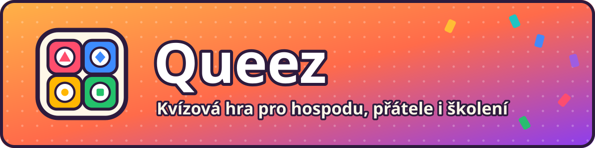
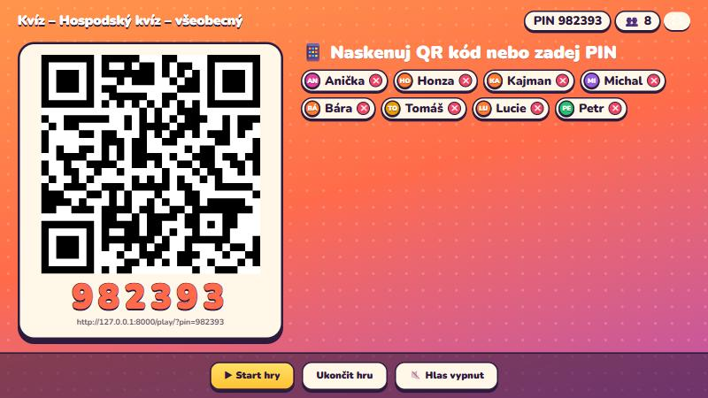
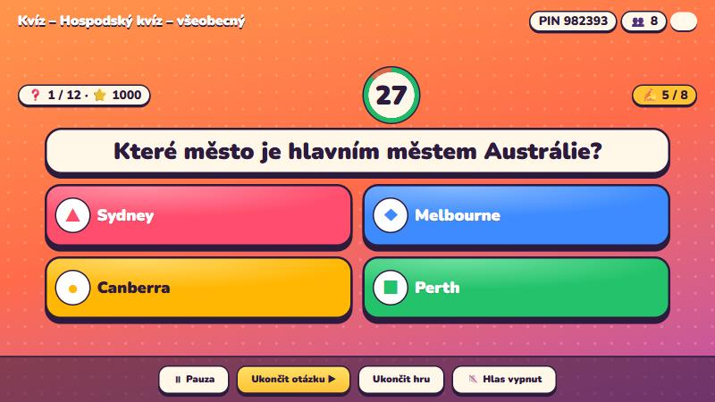
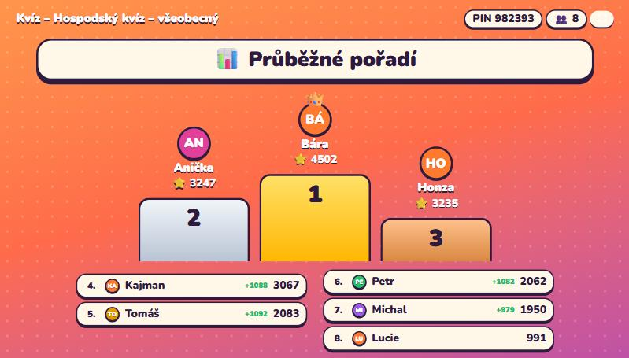
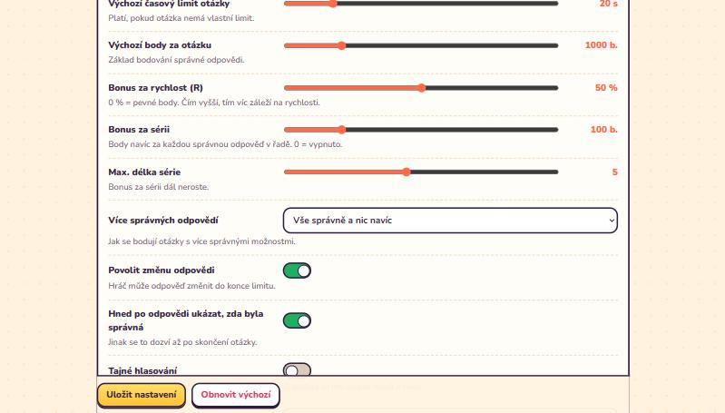
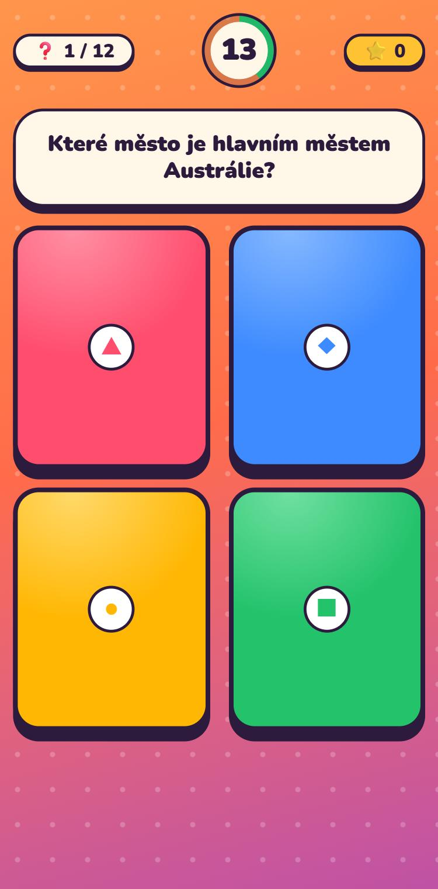
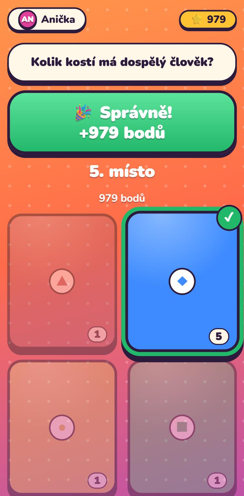

<p align="center"></p>

# Kvíz – kvízová aplikace pro hraní s přáteli (PHP + SQLite)

Webová kvízová hra ve stylu Kahoot. Na velké obrazovce (nebo jen z mobilu v hlasovém režimu) běží hra,
hráči odpovídají na svých telefonech. Celé rozhraní je česky.

- **Backend:** PHP 8.2+ (php-fpm), SQLite. Žádný framework, žádný Composer, žádný build.
- **Frontend:** čisté HTML, CSS a JavaScript, nic se nenačítá z CDN.
- **Nasazení:** zkopírujete složku na server a nastavíte pár věcí. Postup je níže.

---

## Ukázky

<table>
  <tr>
    <td align="center" width="50%"><br><sub>Obrazovka moderátora – QR kód, PIN a hráči v lobby</sub></td>
    <td align="center" width="50%"><br><sub>Otázka s odpočtem a barevnými odpověďmi</sub></td>
  </tr>
  <tr>
    <td align="center"><br><sub>Pořadí hráčů na stupních vítězů</sub></td>
    <td align="center"><br><sub>Administrace – nastavení hry</sub></td>
  </tr>
</table>

<table>
  <tr>
    <td align="center" width="50%"><br><sub>Telefon hráče – otázka</sub></td>
    <td align="center" width="50%"><br><sub>Telefon hráče – správná odpověď</sub></td>
  </tr>
</table>
> **Vývoj a další úpravy:** architektura, konvence, testy a postup aktualizace jsou popsané v [CLAUDE.md](CLAUDE.md); původní zadání v [docs/ZADANI.md](docs/ZADANI.md).

## 1. Co budete potřebovat

- Linuxový server nebo kontejner (popis je pro **Debian 12**) s webovým serverem **Caddy**.
- Přístup přes SSH a přenos souborů (WinSCP / SFTP).
- Volitelně reverzní proxy s HTTPS a veřejnou doménou (kapitola 6), pokud chcete hrát i mimo domácí síť.
- Volitelně klíč ke **Gemini API** (aistudio.google.com) pro generování otázek.

---

## 2. Instalace krok za krokem (Debian)

Příkazy se píší do terminálu na serveru (SSH). Začínají-li `sudo`, pište je včetně něj; jste-li přihlášeni jako `root`, `sudo` vynechte.

### Krok 1 – balíčky

```bash
sudo apt update
sudo apt install -y php-fpm php-cli php-sqlite3 php-curl php-mbstring unzip
```

Ověřte, že PHP má všechna potřebná rozšíření (musí vypsat všech šest řádků):

```bash
php -m | grep -E '^(curl|fileinfo|mbstring|openssl|pdo_sqlite|sqlite3)$'
```

Zjistěte, jakou verzi PHP máte (hodí se níže, v textu značena `<verze>`, např. `8.2`):

```bash
ls /etc/php
```

### Krok 2 – nahrání aplikace

Nahrajte složku `kviz` (včetně podsložek `public`, `src`, `deploy`, `tools`) do `/var/www/kviz` pomocí WinSCP.
Nenahrávejte žádný soubor `config.php`, složku `data` ani `logs` z jiného počítače.

> Složka `public` je **jediná**, která smí být dostupná z webu. Všechno ostatní (`src`, `data`, `config.php`) leží vedle ní a web na to nedosáhne.

### Krok 3 – složky a práva

PHP běží jako uživatel `www-data` a musí umět zapisovat do `data` (databáze, nahrané obrázky, šifrovaný klíč) a `logs`.

```bash
cd /var/www/kviz
sudo mkdir -p data logs
sudo chown -R www-data:www-data data logs
sudo chmod -R 750 data logs
```

### Krok 4 – konfigurace a heslo

```bash
sudo cp config.example.php config.php
sudo php -r "echo password_hash('SEM-DEJTE-SILNE-HESLO', PASSWORD_DEFAULT), PHP_EOL;"
```

Vypsaný řetězec (začíná `$2y$`) vložte do `config.php` jako `admin_password_hash`:

```bash
sudo nano config.php
```

Nastavte také `base_url` – adresu, na které budou hráči aplikaci otevírat, **bez lomítka na konci** (např. `https://kviz.vase-domena.cz`).
Z ní se tvoří QR kód. Poté zamkněte práva:

```bash
sudo chown root:www-data config.php
sudo chmod 640 config.php
```

> Při úpravách `config.php` ukládejte soubor jako **UTF-8 bez BOM**. Jinak PHP před každou odpovědí vypíše neviditelný znak a aplikace se rozbije.

### Krok 5 – PHP-FPM (výkon)

Hráči se ptají serveru každou vteřinu, proto aplikace používá vlastní pooly pracovníků (`deploy/php-fpm-kviz.conf`):

```bash
sudo cp /var/www/kviz/deploy/php-fpm-kviz.conf /etc/php/<verze>/fpm/pool.d/kviz.conf
sudo php-fpm<verze> -t
sudo systemctl restart php<verze>-fpm
ls /run/php/
```

Poslední příkaz musí ukázat soubory `kviz.sock` a `kviz-slow.sock`.

> **Výchozí pool `www` NEVYPÍNEJTE**, pokud na stejném serveru běží jiné weby v PHP (používají jeho socket `php<verze>-fpm.sock`). Aplikace Kvíz ho nepotřebuje, ale ostatní weby ano. Vypínat ho smíte jen na serveru, kde běží výhradně Kvíz.

**Kolik pracovníků nastavit (`pm.max_children`).**
Jeden požadavek hry trvá jen několik milisekund, takže jeden pracovník zvládne desítky až stovky požadavků za vteřinu.
Pro 50 hráčů (50 požadavků za vteřinu) tedy stačí pár pracovníků; číslo `max_children` hlídá především **špičky**, kdy se všichni ozvou ve stejný okamžik.

Pravidlo: `max_children` ≈ polovina počtu hráčů, ale nejvýš to, co unese paměť:

```
max_children = (paměť kontejneru × 0,5) ÷ paměť jednoho pracovníka
```

Paměť jednoho pracovníka zjistíte za běhu (po chvíli používání aplikace):

```bash
ps -C php-fpm<verze> -o rss= | awk '{s+=$1;n++} END {printf "%.0f MB na jednoho\n", s/n/1024}'
```

Příklad: kontejner s 1 GB a pracovníkem o 30 MB → `(1024 × 0,5) ÷ 30 ≈ 17`. Výchozích **25** je vhodných od cca 1,5 GB RAM.
Při menší paměti číslo snižte a `pm.start_servers`, `pm.min_spare_servers`, `pm.max_spare_servers` držte pod ním.
Po změně: `sudo systemctl reload php<verze>-fpm`.

Zda se požadavky řadí do fronty, poznáte z logu PHP-FPM (hláška „server reached pm.max_children setting“):

```bash
sudo journalctl -u php<verze>-fpm | grep max_children
```

Pool `kviz-slow` obsluhuje jen pomalé věci (Gemini generování, Gemini TTS, záloha/obnova) a má vlastní 3 pracovníky a limit 130 s.
Pool `kviz` ukončí zaseknutý požadavek po 20 s (`request_terminate_timeout`), aby neblokoval pracovníka.

### Krok 6 – Caddy

Přidejte blok z `Caddyfile.example` do `/etc/caddy/Caddyfile` (na server přidejte jen to, co tam ještě nemáte):

```bash
sudo nano /etc/caddy/Caddyfile
sudo caddy validate --config /etc/caddy/Caddyfile
sudo systemctl reload caddy
```

- **Port** (výchozí 87) změníte přepsáním čísla na dvou místech v bloku (`servers :87` a `:87`). Nesmí být obsazený jinou službou.
- Globální blok `{ ... }` smí být v Caddyfile jen jednou a musí být úplně nahoře. Máte-li ho už, vložte do něj jen část `servers :87 { ... }`.

### Krok 7 – první spuštění

V prohlížeči otevřete `http://<IP-serveru>:<port>/admin/`, přihlaste se heslem z kroku 4 a vytvořte první kvíz.
Hráči se připojují na `/play/`.

Když něco nejde, podívejte se do `/var/www/kviz/logs/error.log` (kapitola 9).

---

## 3. Jak se hraje

1. V adminu u kvízu klikněte na **▶ Spustit hru** – otevře se obrazovka moderátora s QR kódem a PINem.
2. Hráči naskenují QR kód (nebo zadají PIN na `/play/`), napíší jméno a čekají v lobby.
3. Moderátor klikne na **Start hry** a dál hru ovládá tlačítky (nebo klávesou Enter / mezerník).
4. Odkaz na obrazovku moderátora obsahuje tajný klíč. Najdete ho v adminu v části **Hry** (tlačítko Otevřít), takže ho lze otevřít i na jiném zařízení. **Nikomu ho neposílejte.**

### Hlasový režim (bez velké obrazovky)

Při spuštění hry zvolte **Režim zobrazení → Bez obrazovky – hlasový režim**.

- Odkaz na obrazovku moderátora otevřete **v mobilu** a ten připojte k Bluetooth reproduktoru.
- Hráči vidí text otázky i odpovědí na svých telefonech (u odpovědí jsou písmena A–F).
- Telefon moderátora nahlas čte otázku a možnosti, „zbývá pět sekund“, správnou odpověď, průběžné pořadí (top 3) a vítěze.
- Odpočet začne až po dočtení otázky (+ prodleva z Nastavení → TTS).
- Tlačítka: **Start / Další / Pauza / 🔁 Zopakovat / 🔊 Hlas zapnut·vypnut / Přeskočit čtení**.
- Prohlížeče povolí hlas až po klepnutí, proto hru začněte tlačítkem Start. Když hlas zablokují, ukáže se tlačítko „Povolit hlas“.
- Zařízení moderátora musí mít **český hlas** (Android: Nastavení → Převod textu na řeč; iPhone má hlas „Zuzana“).
  Bez něj lze zapnout záložní **Gemini TTS** (`gemini_tts_enabled` v `config.php` a Nastavení → TTS).

---

## 4. Gemini (generování otázek)

1. V adminu otevřete **Nastavení → Gemini**, vložte API klíč a klikněte na **Otestovat klíč**.
2. Klíč se ukládá **šifrovaně** do `data/secrets/` (mimo databázi i webroot) a do prohlížeče se nikdy nevrací.
   Záloha databáze ho proto neobsahuje. Složku `data/secrets/` nikam nekopírujte.
3. **✨ Generovat** vytvoří *návrh* otázek, který se otevře v editoru. Nic se neukládá, dokud neuložíte kvíz.

Model se mění v Nastavení → Gemini. Pokud generování selže na názvu modelu, zadejte jiný dostupný model.

---

## 5. Test zátěže (doporučeno před první hrou)

Skript simuluje hru s ~20 a více hráči, kteří se ozývají **všichni ve stejnou vteřinu** (nejhorší případ):

```bash
php /var/www/kviz/tools/loadtest.php --url=http://127.0.0.1:<port> --password=HESLO_ADMINA --players=24 --questions=4
```

Skript si vytvoří dočasný kvíz a hru, odehraje je a smaže. Vypíše odezvy (p50 / p95 / max) a verdikt **V POŘÁDKU** nebo **POZOR**.
Při POZOR zvyšte `pm.max_children` (kapitola 2, krok 5). Počet hráčů změníte přepínačem `--players=`.
Spouštějte ho jen proti vlastní instalaci.

---

## 6. Veřejný přístup přes reverzní proxy (HTTPS)

Má-li kvíz fungovat i mimo domácí síť (hospoda, návštěva), dejte před Caddy reverzní proxy s HTTPS a veřejnou doménou
(např. Nginx Proxy Manager). Proxy musí posílat hlavičky `X-Forwarded-Proto` a `X-Forwarded-For` (NPM je posílá samo).

V Nginx Proxy Manageru:

1. **Proxy Host** → Domain Names: vaše doména; Scheme `http`; Forward Hostname/IP: adresa serveru s Caddy; Forward Port: port z kroku 6.
2. **SSL** → požádat o certifikát Let's Encrypt, zapnout *Force SSL*. Websockets nejsou potřeba.
3. **Advanced** → vložte obsah souboru `deploy/npm-advanced.conf`. Zablokuje administraci z internetu.
   Administraci pak otevíráte v domácí síti přímo na adrese Caddy (`http://<IP-serveru>:<port>/admin/`).
4. V `config.php` nastavte `base_url` na veřejnou adresu (`https://vase-domena`) a ověřte, že QR kód v lobby ukazuje na ni.

Co je z internetu dostupné: stránka hráčů, obrazovka moderátora (jen s tajným klíčem) a samotná hra.
Co ne: administrace a její API.

---

## 7. Zálohy a obnova

- **Ruční záloha:** Admin → Nastavení → Údržba → *Stáhnout zálohu databáze*.
- **Automatická záloha** (denně, posledních 14):
  ```bash
  sudo cp /var/www/kviz/deploy/cron-kviz-backup /etc/cron.d/kviz-backup
  ```
  Zálohy jsou v `data/backups`. Pro skutečnou ochranu je kopírujte i mimo server (snapshot kontejneru, jiný disk).
- **Obnova:** Admin → Nastavení → Údržba → *Obnovit ze zálohy*. Dosavadní databáze se předtím uloží do `data/` jako `kviz-pred-obnovou-….sqlite`.
- Šifrovaný Gemini klíč je uložen zvlášť (`data/secrets/`) a do záloh DB nejde; po přenosu na nový server ho zadejte znovu.

---

## 8. Údržba

- **Logy:** `logs/error.log`. Rotaci nastavíte: `sudo cp deploy/logrotate-kviz /etc/logrotate.d/kviz`.
- **Staré hry** se mažou automaticky podle Nastavení → Údržba (výchozí 30 dní).
- **Aktualizace aplikace:** přepište soubory z nové verze (**kromě** `config.php`, `data/` a `logs/`) a pak `sudo systemctl reload php<verze>-fpm`.
  Struktura databáze se při potřebě doplní sama.

---

## 9. Řešení potíží

| Příznak | Co zkontrolovat |
|---|---|
| **502 Bad Gateway** | Existují `/run/php/kviz.sock` a `kviz-slow.sock`? Běží `php<verze>-fpm`? Má socket skupinu `caddy` (`ls -l /run/php/`)? Existuje uživatel `caddy`? |
| **500 / prázdná stránka** | `logs/error.log`; práva složek `data` a `logs` (vlastník `www-data`); chybějící `config.php`. |
| Admin nejde, hesla neplatí | Hash v `config.php` je celý (začíná `$2y$`) a není v uvozovkách rozdělený; soubor je UTF-8 **bez BOM**. |
| QR kód vede na špatnou adresu | `base_url` v `config.php` (bez lomítka na konci). |
| Hráči se nepřipojí z mobilu | Firewall, port Caddy, jsou-li na jiné wifi, musí jít použít veřejnou adresu (kapitola 6). |
| Generování Gemini skončí chybou | Nastavení → Gemini → *Otestovat klíč*; název modelu; `php -m` obsahuje `curl`. |
| Hlas nemluví | Klepněte na „Povolit hlas“; zařízení moderátora potřebuje český hlas nebo zapnuté Gemini TTS. |
| Pomalá hra při hodně hráčích | Spusťte `tools/loadtest.php`; zvyšte `pm.max_children`; `journalctl -u php<verze>-fpm \| grep max_children`. |
| Po úpravě `config.php` to přestalo fungovat | BOM / chybějící čárka nebo uvozovka. Zkontrolujte: `php -l /var/www/kviz/config.php`. |

---

## 10. Bezpečnost (shrnutí)

- Heslo do adminu je uložené jako hash; přihlášení má limit pokusů a CSRF ochranu.
- Veškerá práce s databází jde přes připravené dotazy; výstup se escapuje.
- Gemini API klíč je šifrovaný, uložený mimo databázi a nikdy se neposílá do prohlížeče.
- Hráč si nemůže hlasovat dvakrát (hlídá to server i databáze); odpověď po limitu server odmítne.
- Veřejně vystavte jen to nutné (kapitola 6) a pravidelně aktualizujte systém (`sudo apt update && sudo apt upgrade`).

---

## 11. Struktura

```
kviz/
  public/               ← jediná složka dostupná z webu (webroot)
    index.php  play/  host/  admin/  api/  assets/ (+ vendor/ – lokální QR knihovna)
  src/                  ← PHP třídy (Db, Game, Scoring, Quiz, Gemini, Tts, Auth, Secrets, …)
  data/                 ← SQLite, uploady, TTS cache, šifrovaný klíč (zapisovatelné, mimo web)
  logs/                 ← error.log
  deploy/               ← php-fpm-kviz.conf, npm-advanced.conf, logrotate-kviz, cron-kviz-backup
  tools/                ← loadtest.php, backup.php
  tests/                ← run.php (integrační test hry přes API)
  docs/                 ← ZADANI.md (původní zadání), NAVRH-puvodni.md (historický návrh)
  CLAUDE.md             ← průvodce pro vývoj
  config.example.php    ← vzor konfigurace (config.php vytvoříte kopií)
  Caddyfile.example     ← blok pro Caddy
  README.md
```

Použité součásti třetích stran:
- QR knihovna `public/assets/vendor/qrcode.js` – licence MIT (Kazuhiko Arase).
- Písmo Nunito `public/assets/fonts/` – SIL Open Font License 1.1.

Ukázkový kvíz k importu (Admin → Kvízy → Import JSON): `examples/kviz-hospodsky-vseobecny.json`.

## Licence

Projekt je zveřejněn pod licencí **MIT** – viz soubor [LICENSE](LICENSE).
Součásti třetích stran mají vlastní licence: QR knihovna `public/assets/vendor/qrcode.js` (MIT, Kazuhiko Arase) a písmo Nunito v `public/assets/fonts/` (SIL Open Font License 1.1).
